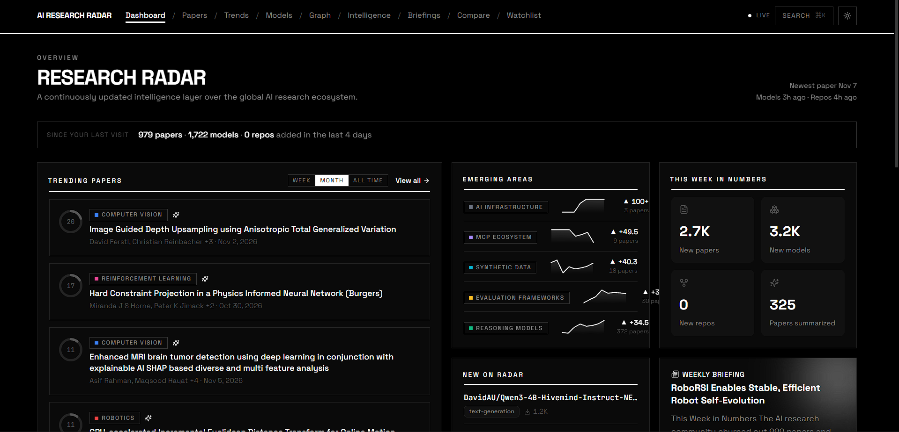

# AI Research Radar: What's Happening in AI Research, and Why

A continuously updated intelligence layer over AI research. It pulls in new arXiv papers, Hugging Face models and GitHub repositories several times a day, scores and summarizes them, links them into a knowledge graph, and then reasons over that graph: which areas are accelerating, which overlooked papers show the early signs of mattering, which ideas are leaking from one field into another, and which labs and researchers are moving. Every Monday it writes a briefing of the week.

Built with Next.js, FastAPI, PostgreSQL with pgvector, Redis and LLM summaries (Groq), on public data from arXiv, Hugging Face, GitHub, Semantic Scholar, OpenAlex, Hacker News and Reddit.

> **What it's for:** a single place to follow AI research as it happens, and to understand a paper, a trend or a lab in context instead of as one more link in a feed.

**Live demo:** [ai-research-radar.vercel.app](https://ai-research-radar.vercel.app) (API docs at [ai-research-radar-api-xdkz.onrender.com/docs](https://ai-research-radar-api-xdkz.onrender.com/docs))



---

## Disclaimer

**AI Research Radar is a learning project, not a research-evaluation tool.** Scores, growth figures, "sleeping giant" picks and frontier predictions are heuristics built on a corpus that only goes back to mid-2026, and the AI summaries are generated by a language model that can be wrong. Read the paper before citing anything. See Honest Limitations for the specifics.

---

## Findings

Real problems found while running this, and what changed:

- **arXiv ingestion silently returned nothing.** `feedparser.parse(url)` swallows HTTP errors and hands back an empty feed, so a throttled or failing request looked exactly like "no new papers". The fetch now goes through `requests` with a timeout and status check, retries with backoff, and the job fails loudly when every category fails or the newest paper is more than five days old.
- **Embedding batches hit the quota after two runs a day.** Gemini counts every text inside a batch against its daily cap, not each request. The per-run cap was cut to fit four runs a day.
- **Every trend sat at +100 growth.** Growth compared raw paper counts week over week, so a week where ingestion recovered from an outage looked like explosive growth in every category. It now scores each category's share of all papers that week.
- **The Semantic Scholar job inserted nothing, run after run.** One request per paper against the shared unauthenticated pool was rate-limited almost every time, and the failures were skipped silently. It now uses the batch endpoint (500 papers per request), stores real global citation counts instead of counting only citations between papers already in the database, and uses an API key when one is set.
- **Rate-limited LLM calls crawled instead of failing.** Each call retried six times with up to a minute between tries, so when Groq's quota ran low a summary took about five minutes and the job ran into its 25-minute timeout with no log output. Calls now give up after two minutes of back-off, batch jobs stop at the first long rate limit, and job warnings reach the CI log.
- **The repo corpus stopped growing.** GitHub search results were sorted by all-time stars, so every run got the same famous repositories back. It now also asks for repositories created in the last 30 days.
- **No repository was ever linked to a paper.** Links came only from a repo's one-line description, which almost never contains an arXiv id. The ingest now reads READMEs and links a repo to the tracked papers it cites, skipping READMEs that cite more than three papers (surveys and "awesome" lists).
- **The first visit after a quiet spell took 30 to 60 seconds.** The API host sleeps after 15 idle minutes and keeping it awake would use the hosting quota other projects need. Each ingest run now publishes the read-only pages (dashboard, trends, briefings, the papers the dashboard links to) to Redis, and the web app serves them from there without waking the API.
- **The database was on course to outgrow its storage in about three months.** Half of the models table was raw model-card text that is only read once, to write the model's summary. A weekly retention job clears it, removes low-signal models nothing points at, and thins history older than five weeks to one point per week.
- **"Since your last visit" asked a different question for every visitor,** so it could never be cached and always woke the API. Those answers are now pre-built for every gap from 1 to 30 days.

---

## Features

### Dashboard
- Trending papers for the week, month or all time, emerging areas with this week's paper counts, a weekly briefing preview, breakout and newly added models, new repositories, an activity heatmap and Sleeping Giants.
- A "since your last visit" bar and a data-freshness indicator that flags when a source stops updating.

### Papers
- Search by keyword with category, date, sort and "has AI summary" filters; save any search as a watch.
- A page per paper with an AI summary (contribution, innovation, problem solved, applications, limitations, significance), impact, momentum and innovation scores, citation history, related papers by embedding similarity, Research DNA, the GitHub repositories that implement it, and a chat that answers questions grounded in the paper.
- Side-by-side comparison of up to four papers.

### Trends
- 15 research categories scored for growth, momentum, activity and adoption, with history per category.

### Models and Repositories
- Hugging Face models ranked by popularity and real 7-day download growth, with AI-written model cards.
- GitHub repositories linked to the papers they implement.

### Research Intelligence
- **Sleeping Giants:** papers showing early signs of importance before they are widely cited.
- **Research DNA:** a weighted concept fingerprint for each paper.
- **Idea Propagation, Genealogy and Cross-Pollination:** how ideas move between papers and across fields.
- **Evolution timelines, collaboration clusters, talent flow and lab scorecards** built from author affiliations.
- **Frontier Predictor:** which category is most likely to accelerate next, from a model trained on the trend history.
- **Weekly Briefing:** this week in numbers, big stories, emerging signals and what to watch, every Monday.

### Watchlist
- Bookmarks and topic watches with new-paper counts in the navigation, scoped to an anonymous per-browser id (there are no accounts).

### UI/UX
- A square, monochrome editorial design in light and dark themes, a `Ctrl+K` command palette, a knowledge-graph explorer and an RSS feed.

---

## Data Source

| Source | Type | API Key? | What It Provides |
|--------|------|----------|------------------|
| [arXiv API](https://info.arxiv.org/help/api/) | Atom feed | No | New papers in the AI-related categories: title, abstract, authors, dates, arXiv tags |
| [Hugging Face Hub](https://huggingface.co/docs/hub/api) | REST | Optional | Models, downloads, likes, tags and model cards |
| [GitHub REST API](https://docs.github.com/rest) | REST | Optional (token raises limits) | Repositories, stars and README text for paper links |
| [Semantic Scholar Graph API](https://api.semanticscholar.org/) | REST (batch) | Optional | Global citation counts and references between papers |
| [OpenAlex](https://openalex.org) | REST | No | Author affiliations per paper, for labs and talent flow |
| [Hacker News (Algolia)](https://hn.algolia.com/api) and Reddit | REST | No | Discussion of tracked papers |
| [Groq](https://console.groq.com) (gpt-oss models) | OpenAI-compatible chat API | Yes | Paper and model summaries, Research DNA, briefings, chat |
| [Google Gemini](https://aistudio.google.com) | Embeddings API | Yes | 384-dimension abstract embeddings for search and related papers |

---

## Tech Stack

| Layer | Technology | Details |
|-------|------------|---------|
| **Frontend** | Next.js 14 (App Router) + TypeScript | TanStack Query, Tailwind, server route handlers that proxy the API and read snapshots |
| **Visualization** | D3.js + Recharts | Knowledge graph, radar, sparklines, score rings |
| **Backend** | FastAPI (Python 3.12) | REST under `/api/v1`, cursor pagination |
| **Jobs** | Python workers run on GitHub Actions | Ingestion, AI backfill, scoring, graph, intelligence, retention and snapshots |
| **Database** | PostgreSQL + pgvector (Supabase) | Vector similarity, full-text search, materialized views |
| **Cache and snapshots** | Redis (Upstash) | API cache, rate limiting, pre-built page snapshots read over REST |
| **AI** | Groq (OpenAI-compatible), Gemini embeddings, or Ollama locally | Per-lane provider routing with failover and rate-limit handling |
| **ML** | scikit-learn, NetworkX, python-louvain | Frontier predictor and community detection |
| **Hosting** | Vercel (web), Render (API), Supabase, Upstash | Blueprint in `render.yaml` |
| **CI** | GitHub Actions | Ruff and pytest for the API, a production build for the web app |

---

## Prerequisites

- **Node.js 20+**: [nodejs.org](https://nodejs.org)
- **Python 3.12+**: [python.org](https://python.org)
- **Docker Desktop** for the local Postgres and Redis stack: [docker.com](https://docker.com)
- **API keys** (all optional for a local run): Groq for summaries, Gemini for embeddings, plus Hugging Face, GitHub and Semantic Scholar keys for higher rate limits. Without an LLM key the app still ingests and scores; summaries are skipped. [Ollama](https://ollama.com) works as a fully local alternative.

---

## Quick Start

```bash
git clone https://github.com/HalcyonVector/AI-Research-Radar.git
cd AI-Research-Radar/infra/docker
docker compose up -d          # Postgres + pgvector, Redis, API, workers
```

The API runs migrations and seeds the 15 research categories on start. API docs are at http://localhost:8000/docs.

Run the web app against it:

```bash
cd ../../apps/web
npm install
cp .env.local.example .env.local   # API_BASE_URL=http://localhost:8000
npm run dev                        # http://localhost:2700
```

Run any job by hand, for example an arXiv fetch:

```bash
cd ../api
python -m src.workers.run_job workers.ingestion.arxiv.run '{}'
```

### Deploying

Vercel builds `apps/web`; Render builds the API from `render.yaml`; the database and Redis are Supabase and Upstash. Scheduled work runs in `.github/workflows/ingest-cron.yml` on the GitHub Actions runner, which talks to the database directly. It needs the `DATABASE_URL`, `OPENAI_API_KEY` (Groq) and `GEMINI_API_KEY` secrets, plus `UPSTASH_REDIS_REST_URL` and `UPSTASH_REDIS_REST_TOKEN` (also set on Vercel) for snapshots. [docs/DEPLOYMENT_GUIDE.md](docs/DEPLOYMENT_GUIDE.md) walks through each service.

---

## Project Structure

```
AI-Research-Radar/
├── render.yaml                  # Render Blueprint for the API
├── apps/
│   ├── api/                     # FastAPI backend and jobs (Python 3.12)
│   │   ├── src/
│   │   │   ├── main.py          # App factory and /health
│   │   │   ├── config.py        # Settings from environment variables
│   │   │   ├── models/          # SQLAlchemy tables
│   │   │   ├── routers/         # papers, trends, models, search, graph, dashboard,
│   │   │   │                    #   briefings, intelligence, watches, bookmarks
│   │   │   ├── services/        # Query and serialization logic
│   │   │   ├── ai/              # LLM client, embeddings, prompts, vocabulary
│   │   │   └── workers/         # ingestion, ai, scoring, graph, intelligence,
│   │   │                        #   maintenance, snapshots, run_job.py
│   │   ├── migrations/          # Alembic
│   │   └── tests/unit/          # pytest
│   └── web/                     # Next.js 14 frontend
│       └── src/
│           ├── app/             # Pages and /api route handlers
│           ├── components/      # dashboard, papers, trends, models, graph, intelligence
│           ├── hooks/ lib/ stores/ types/
├── infra/
│   ├── docker/                  # Dockerfiles and docker-compose.yml
│   └── scripts/                 # Seeding, backfills and one-off crawls
├── docs/
│   ├── DEPLOYMENT_GUIDE.md
│   ├── adr/                     # Architecture decision records
│   ├── screenshots/
│   └── spec/
└── .github/workflows/           # ci.yml, ingest-cron.yml
```

---

## Architecture

```
GitHub Actions (every 6 hours, plus a weekly run on Mondays)
  │
  ├─ ingest: arXiv, Hugging Face, GitHub (+ README links), Semantic Scholar,
  │          OpenAlex, Hacker News and Reddit
  ├─ enrich: Gemini embeddings, Groq summaries (capped per run)
  ├─ score:  paper impact / momentum / innovation, category trends, model growth
  ├─ graph and daily intelligence: edges, Research DNA, breakthrough scores
  ├─ weekly: propagation, genealogy, cross-pollination, evolution, clusters,
  │          frontier predictor, briefing, retention
  └─ snapshots: render public pages to JSON and write them to Upstash
        │
        ▼
Supabase Postgres + pgvector ◀──── FastAPI on Render (search, chat, watches,
        │                           anything not snapshotted)
        ▼                                   ▲
Upstash Redis (snapshots, cache)            │
        │                                   │
        └──────────▶ Next.js on Vercel ─────┘
                     serves snapshots first, falls back to the API
```

Jobs run in their own process on the Actions runner (`src/workers/run_job.py`), so the API never carries their memory. Every response from a snapshotted path carries an `X-Snapshot` header (`hit`, `miss`, `off`, `http-<status>`) so a misconfiguration is visible from outside.

---

## Testing

```bash
cd apps/api
pytest tests/unit -q
```

**29 unit tests (pytest)** cover scoring formulas and growth on category share, cursor pagination, arXiv id extraction, the job lock, LLM retry behaviour (a long `Retry-After` gives up without waiting, short waits are honoured, total back-off is capped) and snapshot key construction, which must match the web app's. CI also runs Ruff and a production build of the web app on every push.

Ingestion, scoring and the intelligence jobs are validated against live data: each change in Findings was checked with a read-only dry run against the production database before it shipped, and every scheduled run reports per-job results and warnings in the Actions log.

---

## Honest Limitations

- **The corpus starts in mid-2026,** so citation counts, impact scores and anything built on history (genealogy, growth, the frontier predictor) are thin. Papers cited only by older work look less important than they are.
- **No new papers from Friday to Monday.** arXiv announces on weekday evenings US time, so the newest paper date stays put over the weekend.
- **About a quarter of papers have an AI summary.** Groq's daily quota allows roughly 60 paper summaries a day against several hundred new papers, so the highest-scoring papers are summarized first; any other paper can be summarized on demand from its page.
- **Interactive features can be slow on a first request.** Search, paper chat, watches and pages that aren't snapshotted go to the API host, which sleeps after 15 idle minutes and takes 30 to 60 seconds to wake.
- **Scheduled runs are late.** GitHub delays scheduled workflows, so the 6-hour cadence is closer to every 8 or 9 hours.
- **Category assignment uses arXiv tags and keywords,** not a trained classifier, so papers on the boundary between two areas can land in the less obvious one.
- **Growth scores are capped at plus or minus 100,** and a category with very few papers can swing to the cap on small changes.
- **Repository links rely on READMEs citing an arXiv id.** Implementations that link only to a project page or a PDF are missed.
- **Watches and bookmarks live in one browser,** tied to an anonymous id rather than an account.

---

## Suggested Future Features

- **Papers with Code style benchmarks:** track reported results per task, from real leaderboard data.
- **Snapshots for more pages,** such as model pages and category pages, ranked by traffic.
- **A trained category classifier** using the embeddings already stored, to fix boundary cases.
- **Export** of briefings and paper lists to CSV or PDF.
- **An HNSW vector index** once the corpus is large enough for IVFFlat recall to matter.

---

## Author

**Sagnik**

GitHub: [@HalcyonVector](https://github.com/HalcyonVector)

---

## License

MIT License. See [LICENSE](LICENSE). Free to use, modify and distribute, with no warranty. Paper metadata comes from arXiv under its API terms of use; model and repository data come from the Hugging Face Hub and GitHub APIs.
