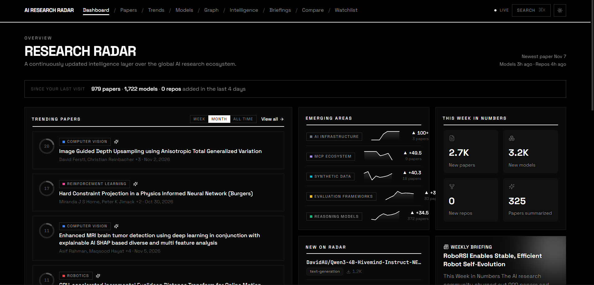

# AI Research Radar: What's Happening in AI Research, and Why

Which parts of AI research are growing, which new papers are starting to matter, and does code follow the papers? AI Research Radar answers those questions from public data. Several times a day it collects new arXiv papers in 15 AI research areas and joins them to their citations (Semantic Scholar), their authors' institutions (OpenAlex), the Hugging Face models and GitHub repositories that implement them, and the discussion they get on Hacker News and Reddit. Each paper is classified into an area, scored for impact, momentum and novelty, and kept as a dated history, so trends are measured as each area's share of all papers per week rather than raw counts that swing with ingestion. The web app is how the analysis is explored: area trends, papers ranked by signal, the links between papers, models and code, and a weekly written briefing.

Built with Python (FastAPI, SQLAlchemy, scikit-learn, NetworkX), PostgreSQL with pgvector, LLM summaries (Groq) and a Next.js front end, on public data from arXiv, Semantic Scholar, OpenAlex, Hugging Face, GitHub, Hacker News and Reddit.

> **What it's for:** following AI research as it happens, and judging a paper, an area or a lab in context (how fast it is growing, who builds on it, whether code exists) instead of as one more link in a feed.

**Live demo:** [ai-research-radar.vercel.app](https://ai-research-radar.vercel.app) (API docs at [ai-research-radar-api-xdkz.onrender.com/docs](https://ai-research-radar-api-xdkz.onrender.com/docs))



---

## Disclaimer

**AI Research Radar is a learning project, not a research-evaluation tool.** Scores, growth figures, "sleeping giant" picks and frontier predictions are heuristics built on a corpus that only goes back to mid-2026, and the AI summaries are generated by a language model that can be wrong. Read the paper before citing anything. See Honest Limitations for the specifics.

---

## Findings

From the database on 23 November 2026: 9,645 papers published from 14 June to 19 November 2026, with 72,413 daily metric snapshots. All figures come from read-only SQL against the production database.

- **Five areas make up 85% of new AI papers.** In the two weeks after ingestion was repaired (2 to 15 November, 4,216 papers, about 2,100 a week), Reinforcement Learning had 19.5% of papers, Computer Vision 18.1%, Reasoning Models 17.1%, LLMs 15.5% and Robotics 14.3%. Everything agent-related (AI Agents, Multi-Agent Systems, Coding Agents and MCP) adds up to 7.3%, and RAG to 2.9%.
- **A broken feed doesn't just shrink the data, it skews it.** From 14 September to 25 October the arXiv fetch was failing silently and caught only about 210 papers a week. In that sample Reasoning Models were 32.5% of papers and Robotics 5.5%; once the full feed was restored they were 17.1% and 14.3%. Comparing October with November naively would report Robotics nearly tripling, when what changed was coverage. Trend growth is computed on each area's share of the week's papers, which removes swings in volume but not a biased sample like this one, so the job now fails loudly and the dashboard flags a stalled feed instead.
- **Citations arrive late and unevenly.** Only 7% of papers under 40 days old have been cited at all, rising to 32% at 40 to 80 days and 48% at 120 to 160 days. Among papers at least 60 days old the median is 0 citations and the 90th percentile is 4. The 1% most-cited papers hold 27.5% of all citations and the top 10% hold 58.6%, so an average citation count says little about a typical paper.
- **The October scores did not predict November citations.** For 1,289 papers published before 1 October, the impact score recorded on 22 October had a rank correlation of 0.04 with the global citation count on 23 November; even the October citation count managed only 0.10, because October counted citations between tracked papers only, and real Semantic Scholar counts replaced them in mid-November. The momentum score was non-zero for 1 of 2,004 papers that day (119 of 9,645 today). The scores are a ranking aid, not a forecast, until there are a few months of consistent history to test them on.
- **Code links are still too sparse to measure.** Only 54 papers (0.6%) are linked to a GitHub repository (25) or a Hugging Face model (30), and the linked repositories and models carry no creation date, so the paper-to-code delay can't be measured yet. The 17 linked papers older than 30 days were cited more often (82% have a citation, against 37% of the rest), but 17 is too few to draw a conclusion.

---

## Features

### Dashboard
- Trending papers for the week, month or all time, emerging areas with this week's paper counts, a weekly briefing preview, breakout and newly added models, new repositories, an activity heatmap and Sleeping Giants.
- A "since your last visit" bar and a data-freshness line: when the data was built, the newest paper, when arXiv publishes next, and a flag when a source stops updating.

### Papers
- Search by keyword with category, date, sort and "has AI summary" filters; save any search as a watch.
- A page per paper with an AI summary (contribution, innovation, problem solved, applications, limitations, significance), impact, momentum and innovation scores, citation history, related papers by embedding similarity, Research DNA, the GitHub repositories that implement it, and a chat that answers questions grounded in the paper.
- Side-by-side comparison of up to four papers.

### Trends
- 15 research categories scored for growth, momentum, activity and adoption, with history per category.

### Models and Repositories
- Hugging Face models ranked by popularity and real 7-day download growth, with AI-written model cards.
- GitHub repositories linked to the papers they implement.

### Research Intelligence
- **Sleeping Giants:** papers showing early signs of importance before they are widely cited.
- **Research DNA:** a weighted concept fingerprint for each paper.
- **Idea Propagation, Genealogy and Cross-Pollination:** how ideas move between papers and across fields.
- **Evolution timelines, collaboration clusters, talent flow and lab scorecards** built from author affiliations.
- **Frontier Predictor:** which category is most likely to accelerate next, from a model trained on the trend history.
- **Weekly Briefing:** this week in numbers, big stories, emerging signals and what to watch, every Monday.

### Watchlist
- Bookmarks and topic watches with new-paper counts in the navigation, scoped to an anonymous per-browser id (there are no accounts).

### UI/UX
- A square, monochrome editorial design in light and dark themes, a `Ctrl+K` command palette, a knowledge-graph explorer and an RSS feed.

---

## Data Source

| Source | Type | API Key? | What It Provides |
|--------|------|----------|------------------|
| [arXiv API](https://info.arxiv.org/help/api/) | Atom feed | No | New papers in the AI-related categories: title, abstract, authors, dates, arXiv tags |
| [Hugging Face Hub](https://huggingface.co/docs/hub/api) | REST | Optional | Models, downloads, likes, tags and model cards |
| [GitHub REST API](https://docs.github.com/rest) | REST | Optional (token raises limits) | Repositories, stars and README text for paper links |
| [Semantic Scholar Graph API](https://api.semanticscholar.org/) | REST (batch) | Optional | Global citation counts and references between papers |
| [OpenAlex](https://openalex.org) | REST | No | Author affiliations per paper, for labs and talent flow |
| [Hacker News (Algolia)](https://hn.algolia.com/api) and Reddit | REST | No | Discussion of tracked papers |
| [Groq](https://console.groq.com) (gpt-oss models) | OpenAI-compatible chat API | Yes | Paper and model summaries, Research DNA, briefings, chat |
| [Google Gemini](https://aistudio.google.com) | Embeddings API | Yes | 384-dimension abstract embeddings for search and related papers |

---

## Tech Stack

| Layer | Technology | Details |
|-------|------------|---------|
| **Frontend** | Next.js 14 (App Router) + TypeScript | TanStack Query, Tailwind, server route handlers that proxy the API and read snapshots |
| **Visualization** | D3.js + Recharts | Knowledge graph, radar, sparklines, score rings |
| **Backend** | FastAPI (Python 3.12) | REST under `/api/v1`, cursor pagination |
| **Jobs** | Python workers run on GitHub Actions | Ingestion, AI backfill, scoring, graph, intelligence, retention and snapshots |
| **Database** | PostgreSQL + pgvector (Supabase) | Vector similarity, full-text search, materialized views |
| **Cache and snapshots** | Redis (Upstash) | API cache, rate limiting, pre-built page snapshots read over REST |
| **AI** | Groq (OpenAI-compatible), Gemini embeddings, or Ollama locally | Per-lane provider routing with failover and rate-limit handling |
| **ML** | scikit-learn, NetworkX, python-louvain | Frontier predictor and community detection |
| **Hosting** | Vercel (web), Render (API), Supabase, Upstash | Blueprint in `render.yaml` |
| **CI** | GitHub Actions | Ruff and pytest for the API, a production build for the web app |

---

## Prerequisites

- **Node.js 20+**: [nodejs.org](https://nodejs.org)
- **Python 3.12+**: [python.org](https://python.org)
- **Docker Desktop** for the local Postgres and Redis stack: [docker.com](https://docker.com)
- **API keys** (all optional for a local run): Groq for summaries, Gemini for embeddings, plus Hugging Face, GitHub and Semantic Scholar keys for higher rate limits. Without an LLM key the app still ingests and scores; summaries are skipped. [Ollama](https://ollama.com) works as a fully local alternative.

---

## Quick Start

```bash
git clone https://github.com/HalcyonVector/AI-Research-Radar.git
cd AI-Research-Radar/infra/docker
docker compose up -d          # Postgres + pgvector, Redis, API, workers
```

The API runs migrations and seeds the 15 research categories on start. API docs are at http://localhost:8000/docs.

Run the web app against it:

```bash
cd ../../apps/web
npm install
cp .env.local.example .env.local   # API_BASE_URL=http://localhost:8000
npm run dev                        # http://localhost:2700
```

Run any job by hand, for example an arXiv fetch:

```bash
cd ../api
python -m src.workers.run_job workers.ingestion.arxiv.run '{}'
```

### Deploying

Vercel builds `apps/web`; Render builds the API from `render.yaml`; the database and Redis are Supabase and Upstash. Scheduled work runs in `.github/workflows/ingest-cron.yml` on the GitHub Actions runner, which talks to the database directly. It needs the `DATABASE_URL`, `OPENAI_API_KEY` (Groq) and `GEMINI_API_KEY` secrets, plus `UPSTASH_REDIS_REST_URL` and `UPSTASH_REDIS_REST_TOKEN` (also set on Vercel) for snapshots. [docs/DEPLOYMENT_GUIDE.md](docs/DEPLOYMENT_GUIDE.md) walks through each service.

---

## Project Structure

```
AI-Research-Radar/
├── render.yaml                  # Render Blueprint for the API
├── apps/
│   ├── api/                     # FastAPI backend and jobs (Python 3.12)
│   │   ├── src/
│   │   │   ├── main.py          # App factory and /health
│   │   │   ├── config.py        # Settings from environment variables
│   │   │   ├── models/          # SQLAlchemy tables
│   │   │   ├── routers/         # papers, trends, models, search, graph, dashboard,
│   │   │   │                    #   briefings, intelligence, watches, bookmarks
│   │   │   ├── services/        # Query and serialization logic
│   │   │   ├── ai/              # LLM client, embeddings, prompts, vocabulary
│   │   │   └── workers/         # ingestion, ai, scoring, graph, intelligence,
│   │   │                        #   maintenance, snapshots, run_job.py
│   │   ├── migrations/          # Alembic
│   │   └── tests/unit/          # pytest
│   └── web/                     # Next.js 14 frontend
│       └── src/
│           ├── app/             # Pages and /api route handlers
│           ├── components/      # dashboard, papers, trends, models, graph, intelligence
│           ├── hooks/ lib/ stores/ types/
├── infra/
│   ├── docker/                  # Dockerfiles and docker-compose.yml
│   └── scripts/                 # Seeding, backfills and one-off crawls
├── docs/
│   ├── DEPLOYMENT_GUIDE.md
│   ├── adr/                     # Architecture decision records
│   ├── screenshots/
│   └── spec/
└── .github/workflows/           # ci.yml, ingest-cron.yml
```

---

## Architecture

```
GitHub Actions (every 6 hours, plus a weekly run on Mondays)
  │
  ├─ ingest: arXiv, Hugging Face, GitHub (+ README links), Semantic Scholar,
  │          OpenAlex, Hacker News and Reddit
  ├─ enrich: Gemini embeddings, Groq summaries (capped per run)
  ├─ score:  paper impact / momentum / innovation, category trends, model growth
  ├─ graph and daily intelligence: edges, Research DNA, breakthrough scores
  ├─ weekly: propagation, genealogy, cross-pollination, evolution, clusters,
  │          frontier predictor, briefing, retention
  └─ snapshots: render public pages to JSON and write them to Upstash
        │
        ▼
Supabase Postgres + pgvector ◀──── FastAPI on Render (search, chat, watches,
        │                           anything not snapshotted)
        ▼                                   ▲
Upstash Redis (snapshots, cache)            │
        │                                   │
        └──────────▶ Next.js on Vercel ─────┘
                     serves snapshots first, falls back to the API
```

Jobs run in their own process on the Actions runner (`src/workers/run_job.py`), so the API never carries their memory. Every response from a snapshotted path carries an `X-Snapshot` header (`hit`, `miss`, `off`, `http-<status>`) so a misconfiguration is visible from outside.

### Problems found while running it

- **arXiv ingestion silently returned nothing.** `feedparser.parse(url)` swallows HTTP errors and returns an empty feed, so a throttled request looked like "no new papers" (the cause of the skewed sample in Findings). The fetch now checks status, retries with backoff, and fails the job when every category fails or the newest paper is more than five days old.
- **Every trend sat at +100 growth.** Growth compared raw weekly counts, so a week where ingestion recovered looked like explosive growth everywhere. It now scores each area's share of the week's papers.
- **Citation counts only covered papers already in the database.** The Semantic Scholar job was rate-limited almost every time and skipped failures silently. It now uses the batch endpoint (500 papers per request) with an API key and stores global citation counts.
- **No repository was ever linked to a paper.** Links came only from a repo's one-line description. The ingest now reads READMEs and links a repo to the tracked papers it cites, skipping READMEs that cite more than three (surveys and lists), and also searches for repositories created in the last 30 days.
- **Rate-limited LLM calls crawled instead of failing.** Calls now give up after two minutes of back-off and batch jobs stop at the first long rate limit; Gemini embeddings are capped per run because the daily quota counts every text in a batch.
- **The first visit after a quiet spell took 30 to 60 seconds** while the sleeping API host woke up. Each ingest run now publishes the read-only pages, including "since your last visit" for every gap from 1 to 30 days, to Redis, and the web app serves them without waking the API.
- **The database was on course to outgrow its storage in about three months.** A weekly retention job clears raw model cards once summarized, removes low-signal models nothing points at, and thins history older than five weeks to weekly points. Its first run hit the 2-minute statement timeout because no foreign key pointing at `models` was indexed; with the indexes it took the database from 314MB to 175MB in 34 seconds.
- **The web build depended on Google Fonts** and failed when the download did; the fonts now ship with the app.

---

## Testing

```bash
cd apps/api
pytest tests/unit -q
```

**29 unit tests (pytest)** cover scoring formulas and growth on category share, cursor pagination, arXiv id extraction, the job lock, LLM retry behaviour (a long `Retry-After` gives up without waiting, short waits are honoured, total back-off is capped) and snapshot key construction, which must match the web app's. CI also runs Ruff and a production build of the web app on every push.

Ingestion, scoring and the intelligence jobs are validated against live data: each fix under Architecture was checked with a read-only dry run against the production database before it shipped, and every scheduled run reports per-job results and warnings in the Actions log.

---

## Honest Limitations

- **The corpus starts in mid-2026,** so citation counts, impact scores and anything built on history (genealogy, growth, the frontier predictor) are thin. Papers cited only by older work look less important than they are.
- **No new papers on Friday and Saturday nights.** arXiv announces Sunday to Thursday at 20:00 US Eastern, so the newest paper date stays put over the weekend; the dashboard shows when the next batch is due.
- **The data has gaps.** Nothing was ingested for August 2026 and only a partial, skewed sample from mid-September to late October (see Findings), so area trends before 2 November should be read with care.
- **The scores are not validated yet.** October's impact and momentum scores showed no relationship with November's citations, partly because the citation source changed in between. They rank papers within the app; they don't predict impact.
- **About a quarter of papers have an AI summary.** Groq's daily quota allows roughly 60 paper summaries a day against several hundred new papers, so the highest-scoring papers are summarized first; any other paper can be summarized on demand from its page.
- **Interactive features can be slow on a first request.** Search, paper chat, watches and pages that aren't snapshotted go to the API host, which sleeps after 15 idle minutes and takes 30 to 60 seconds to wake.
- **Scheduled runs are late.** GitHub delays scheduled workflows, so the 6-hour cadence is closer to every 8 or 9 hours.
- **Category assignment uses arXiv tags and keywords,** not a trained classifier, so papers on the boundary between two areas can land in the less obvious one.
- **Growth scores are capped at plus or minus 100,** and a category with very few papers can swing to the cap on small changes.
- **Repository links rely on READMEs citing an arXiv id.** Implementations that link only to a project page or a PDF are missed.
- **Watches and bookmarks live in one browser,** tied to an anonymous id rather than an account.

---

## Suggested Future Features

- **Papers with Code style benchmarks:** track reported results per task, from real leaderboard data.
- **Snapshots for more pages,** such as model pages and category pages, ranked by traffic.
- **A trained category classifier** using the embeddings already stored, to fix boundary cases.
- **A score backtest page** that re-runs the October-to-November check in Findings every month, once the citation source has been stable for a few months.
- **Paper-to-code delay,** once repository and model creation dates are stored with each link.

---

## Author

**Sagnik**

GitHub: [@HalcyonVector](https://github.com/HalcyonVector)

---

## License

MIT License. See [LICENSE](LICENSE). Free to use, modify and distribute, with no warranty. Paper metadata comes from arXiv under its API terms of use; model and repository data come from the Hugging Face Hub and GitHub APIs.
